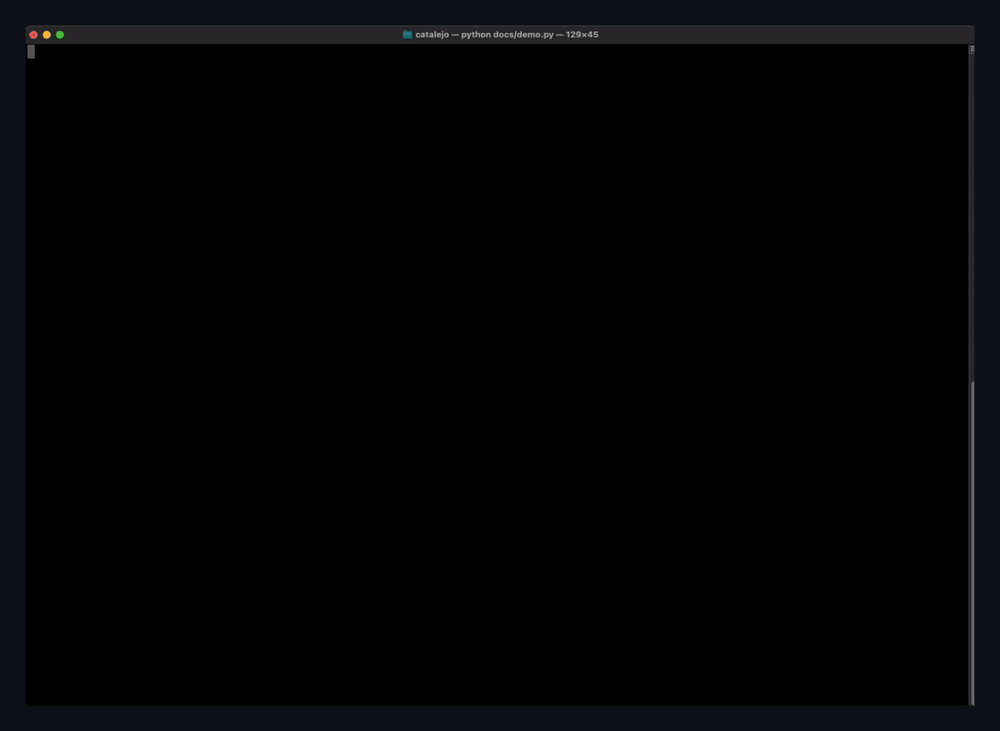

# catalejo

[](https://github.com/polfananas/catalejo/actions/workflows/tests.yml)

> *catalejo* (Spanish): spyglass.

**Spain's securities regulator (CNMV) publishes everything listed companies have to disclose, but only through web forms and PDFs.** catalejo turns that into clean Python objects, and plugs it into AI agents through an MCP server.

Think of it as a small **SEC EDGAR for Spain**.

> *Having had perfect understanding of all things from the very first, to write unto thee in order, that thou mightest know the certainty of those things.* (Luke 1:3-4)



<!-- TODO: second GIF, Claude Desktop using the MCP server -->

```python
>>> import catalejo
>>> for f in catalejo.filings(days=7, kind="IP"):
...     print(f.registered_at, f.issuer, "|", f.title)
2026-11-10 16:20:00+01:00 CONSTRUCCIONES Y AUXILIAR DE FERROCARRILES, S.A | El Consejo de Administración de la Sociedad ha aprobado el Plan Estratégico 2027-2030.
2026-11-09 12:14:00+01:00 ELECNOR, S.A. | Elecnor comunica la propuesta del Consejo de Administración de distribución de un dividendo ...
```

## Install

```bash
pip install catalejo            # library
pip install "catalejo[mcp]"     # + MCP server for Claude and other agents
pip install "catalejo[pdf]"     # + text extraction from filed PDFs
```

Python 3.10+.

## What you can get

**Inside information (IP) and other relevant information (OIR)**, the two channels issuers use to disclose anything that can move the price: results, M&A, takeover bids, guidance, board changes, buybacks...

```python
from datetime import date
import catalejo

catalejo.filings(days=3)                          # everything from the last 3 days, IP + OIR
catalejo.filings(days=30, kind="IP", issuer="cellnex")

# Full history for one company. Filtering by NIF (Spanish tax id) is done
# by the CNMV itself, so years of data come back in a few seconds.
catalejo.filings(since=date(2020, 1, 1), kind="IP", issuer="A64907306")
```

Each `Filing` has `kind`, `registered_at` (timezone-aware, Madrid), `issuer`, `issuer_nif`, `category`, `title`, `registry_number` and `document_url`.

**The text of the filed document:**

```python
f = catalejo.filings(days=10, kind="IP", issuer="A64907306")[0]
print(catalejo.document_text(f))     # needs catalejo[pdf]
```

**The securities (ISINs) of an issuer**, shares and bonds:

```python
>>> [s for s in catalejo.securities("A64907306") if s.is_share]
[Security(isin='ES0105066007', fisn='CLNX/AC 0.25', cfi='ESVUFB', ...)]
```

## Use it from Claude (MCP)

catalejo ships an MCP server with two tools, `latest_filings` and `issuer_filings`, so you can ask things like *"What inside information has Cellnex published since 2023? Group it by topic."*

**Claude Desktop:** add this to `claude_desktop_config.json` (Settings → Developer → Edit Config) and restart the app:

```json
{
  "mcpServers": {
    "catalejo": { "command": "catalejo-mcp" }
  }
}
```

If Claude can't find the command, use the full path from `which catalejo-mcp`.

**Claude Code:** `claude mcp add catalejo -- catalejo-mcp`

## Why not just ask an AI with web search?

Because the CNMV's search pages are forms that search engines barely index. An agent with web search ends up reading press articles: incomplete, late, and you can't tell what's missing. With catalejo it reads the official register directly: every filing, with its exact time, registry number and a link to the original document. And it can do what web search can't, like going through years of history or across every issuer.

## Being a good citizen

catalejo talks only to `cnmv.es`, sends an identifiable User-Agent, makes **at most one request per second** and caches responses on disk (`~/.cache/catalejo`, or set `CATALEJO_CACHE_DIR`). Filed documents never change, so they are downloaded once. Please keep it that way if you fork it.

## Good to know

- **Inside information exists as its own channel since 8 February 2020.** Before that, everything was published as *hechos relevantes*, which catalejo doesn't cover yet.
- Searching by **NIF** is fast (the CNMV filters). Searching by **name** works, but scans every filing in the window, so keep the window short.
- Times are the CNMV's registration time, to the minute.
- Filings come in the language the issuer used, which is almost always Spanish.
- Early days: the API may still change before 1.0.

## Roadmap

- [x] Inside information & other relevant information, with full history
- [x] ISINs per issuer, text of filed PDFs
- [x] MCP server
- [ ] Directors' and managers' dealings (art. 19 MAR): a Spanish OpenInsider
- [ ] Net short positions
- [ ] Takeover bids (OPAs): status, price, spread
- [ ] Fund portfolios
- [ ] CLI

## Data and license

The data comes from the [CNMV](https://www.cnmv.es) public registers and remains subject to the CNMV's [legal notice](https://www.cnmv.es/Portal/utilidades/NotaLegal): reproduce it faithfully, and if you ever sell it, tell your buyers it's free at cnmv.es. catalejo is not affiliated with or endorsed by the CNMV.

Code: MIT. See [LICENSE](https://github.com/polfananas/catalejo/blob/main/LICENSE).
